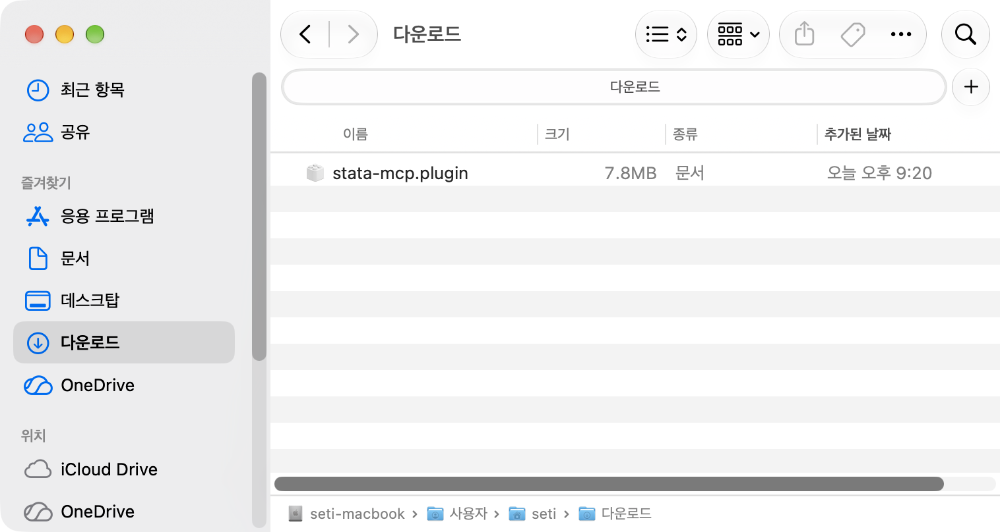
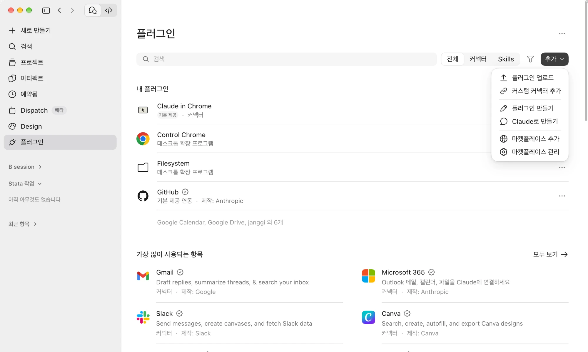
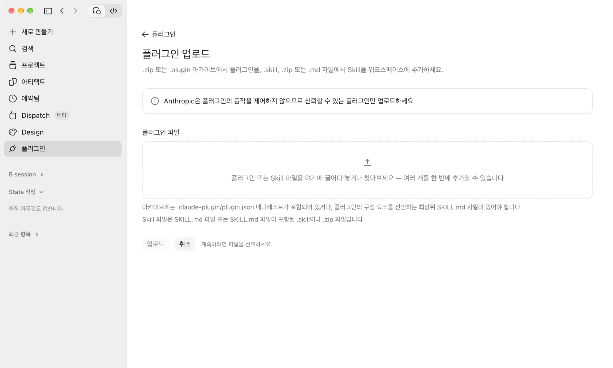
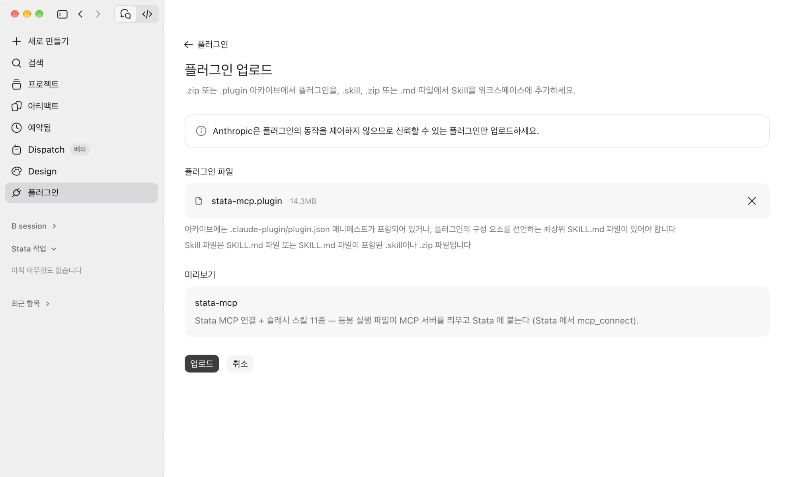
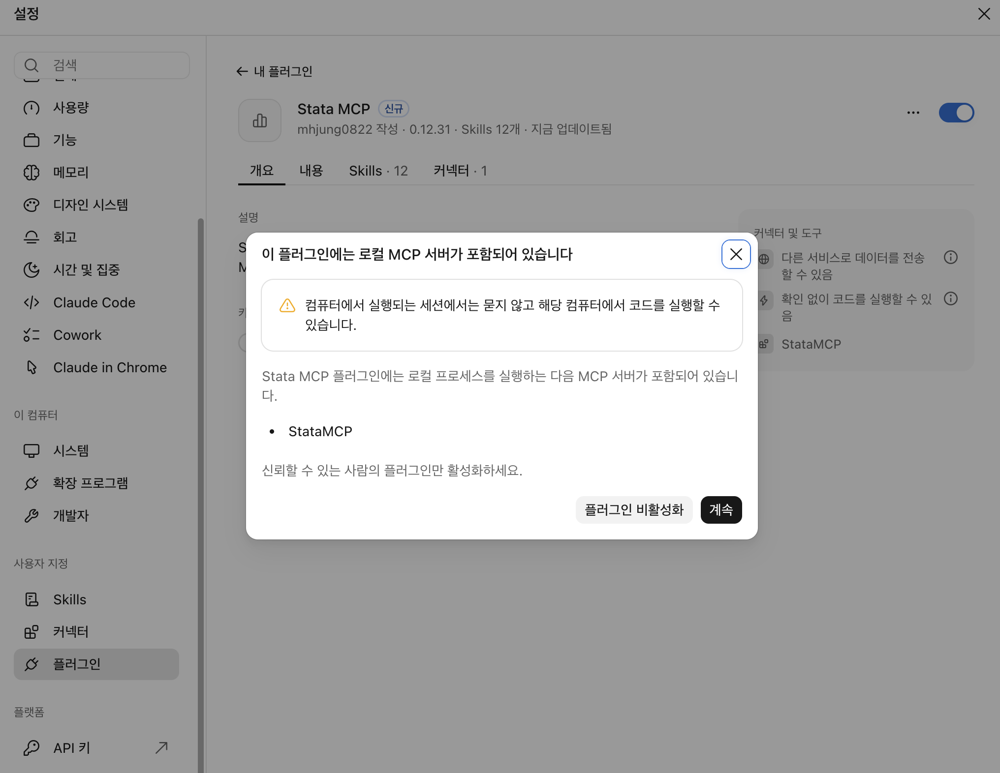
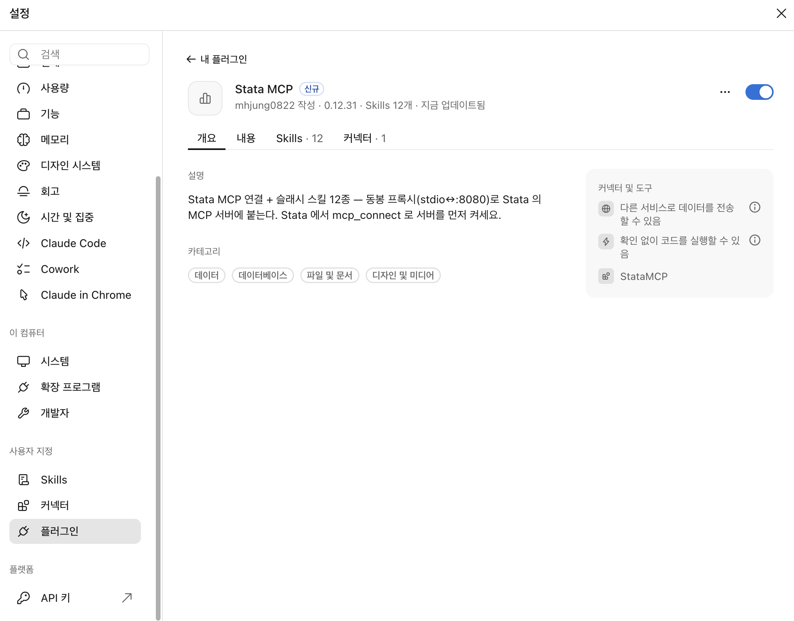

# Stata MCP — Stata × Claude · ChatGPT

> 한국어: [README.md](README.md)

Stata MCP lets Claude and ChatGPT **work with you in Stata (Results window, Data Browser, graphs, and so on), on the same data**. You **exchange analysis commands and results** back and forth: ask for an analysis in chat and it runs right in your Stata, or send results you ran yourself in Stata to the AI to interpret and carry on from there. While connected, you can still use Stata on your own as usual and bring in the AI only when you need it.

[](https://www.youtube.com/@Stata-MCP)

▶ [Watch the demos (YouTube channel)](https://www.youtube.com/@Stata-MCP)

Installation is three steps: **① Stata-side install → ② Start the server → ③ Register in Claude (extension + skills)**.
You can also connect from the ChatGPT desktop app — see section 6.

For usage and troubleshooting after install see [USAGE.en.md](USAGE.en.md).

---

## 1. Prerequisites

| Item | Version |
|------|------|
| Stata | 17+ (19 recommended) |
| Claude Desktop | latest — [download](https://claude.ai/download) |

---

## 2. Stata-side install

Two lines in Stata:

```stata
net install stata-mcp, from("https://raw.githubusercontent.com/mhjung0822/stata-mcp/main/release") replace
```

```stata
mcp_setup, install
```

- `net install …` — installs the Stata commands (ado) and the connection module
- `mcp_setup, install` — downloads the server program and the help DB (~32MB), then connects (internet connection required, first time only)

To update later, **start Stata fresh and run this before connecting**:

```stata
mcp_setup, update
```

- `mcp_setup, update` — reinstalls the latest version and also fetches the server program and help DB when they have changed. If it gives an error, run the two install lines above again

> To apply an update, **restart Stata again** and connect with `mcp_setup`.

> The Claude extension (`.mcpb`) is updated separately. When a new version is out, download the file again from section 4-1 and install it the same way.

> To change the ports (default 8080/8001), edit `BRIDGE_PORT`/`DRONE_PORT` in `.stata_mcp/stata_mcp.properties` under your home folder — the file is created automatically on first start.

> If your PC cannot run the server program, see "서버 프로그램이 실행되지 않는 PC" in [TROUBLESHOOTING.md](TROUBLESHOOTING.md) (Korean).

---

## 3. Start the server

```stata
mcp_setup
```

Connects this Stata to Claude. Run this one line each time you start Stata (on first install, `mcp_setup, install` already connects). You can start Stata and Claude in either order.

> The old command `mcp_connect` still works.

> The server shuts down automatically once both Stata and Claude are closed. You can also start it from the GUI control panel (`db mcp`) — see [USAGE.en.md](USAGE.en.md).

> On connect, Stata MCP checks once for a new version and shows a notice in the Results window if there is one (restart Stata, then run `mcp_setup, update` before connecting). Only the number of connections is counted, anonymously. To turn this off: `mcp_setup, updatecheck(off)`. Versions that are no longer supported won't connect and show a notice instead.

> ⚠️ **If `mcp_setup` says Java 17 or later is required, or a red `java.lang.UnsupportedClassVersionError` appears and the drone won't start** — Stata's bundled Java is outdated. Run `update all` in Stata, **restart Stata**, then run `mcp_setup` again. Details in the troubleshooting section of [USAGE.en.md](USAGE.en.md).

---

## 4. Register in Claude (Claude Desktop · Claude Code)

> For environment issues such as Claude Desktop not activating on Windows, see [TROUBLESHOOTING.md](TROUBLESHOOTING.md) (Korean).

### 4-1. Install the plugin (MCP connection + slash commands)

One package for both Mac and Windows. It works in Claude Desktop and in the Claude Code tab. Pick one of the two methods.

**Method A — marketplace (register once, updates arrive by themselves)**

1. In Claude Desktop, click **Plugins** in the left sidebar
2. Click **Add** at the top right → **Add marketplace** → enter the GitHub address `mhjung0822/stata-mcp`
3. **Install** the **Stata MCP** entry that appears → click **Continue** in the "local MCP server" dialog
4. Under **Add** → **Manage marketplaces**, turn on **Auto-update** so new versions arrive on their own

**Method B — upload the file** (offline, or when method A is not offered)

1. [Download `stata-mcp.plugin`](https://raw.githubusercontent.com/mhjung0822/stata-mcp/main/claude-plugins/stata-mcp.plugin)

   

2. In Claude Desktop, click **Plugins** in the left sidebar

3. Click **Add** at the top right → **Upload plugin**

   

4. **Drag** the downloaded file onto this screen, or pick it with Browse

   

5. When the preview shows **stata-mcp**, click **Upload**

   

6. In the "This plugin includes a local MCP server" dialog, click **Continue**

   

7. Done when the **Stata MCP** page shows **Skills · 11** and **Connectors · 1** with the switch at the top right turned on

   

> Screenshots are from the Korean UI; button positions are the same. Run `mcp_setup` (step 3) in Stata for the tools to work. Updates: method A is automatic (or **Update** on the marketplace entry); for method B upload the new `.plugin` file the same way. See [USAGE.en.md](USAGE.en.md) for the slash commands. In the Claude Code tab they carry the `stata-mcp:` prefix (e.g. `/stata-mcp:stata-exec`). The plugin ships the Korean skill texts; the English skill pack is in [CHAT.en.md](CHAT.en.md).

### 4-2. Also use it in chat (optional)

The chat surface uses the extension and the skill zip instead of the plugin — see [CHAT.en.md](CHAT.en.md). Skip this if you only use Claude Desktop or Claude Code.

---

## 5. Connection test

Start with both Stata and Claude Desktop **fully quit** — closing the Claude window
leaves it running in the background, so quit via the tray icon → **Quit** on Windows,
or **⌘Q** on Mac. Then start them in this order:

```
1. Start Stata → run mcp_setup
2. Start Claude Desktop
```

Either order works.

Then, in a Claude Desktop conversation (or the Claude Code tab), type either of these:

```
What Stata version am I running?
```

```
/stata-setup
```

If the version and edition come back (e.g. StataNow/MP 19.5), the installation is complete. `/stata-setup` also checks the environment and working folder in one go (in the Claude Code tab: `/stata-mcp:stata-setup`).

If not, check in order:

1. Stata Results window — does the `mcp_setup` output say `Ready for commands`? (if not, see step 3, Start the server)
2. **Plugins** in the left sidebar — is **Stata MCP** switched on? (for chat: Settings → Extensions). If it is on but nothing works, fully quit and relaunch Claude Desktop

For everyday usage see [USAGE.en.md](USAGE.en.md) — startup order, control panel, push notifications, help lookup, troubleshooting. Rare environment issues: [TROUBLESHOOTING.md](TROUBLESHOOTING.md) (Korean).

---

## 6. Connect from the ChatGPT desktop app (optional)

Instead of Claude, you can connect the ChatGPT desktop app to the same Stata. No extension file is needed — you only register an address.

1. In the ChatGPT desktop app, click your **profile** at the bottom left → **Settings** → open **Integrations → Plugins** in the left list.

   

2. Open the **MCP** tab at the top, then click **Add** (top right) → **Add MCP server**.

   

3. Fill in the form as below and click **Save** at the bottom right.
   - **Name**: `Stata-mcp` (any name is fine)
   - **Type**: select **Streamable HTTP**
   - **URL**: `http://127.0.0.1:8080/mcp`
   - Leave the bearer token, headers, and env-var headers fields **empty**

   

4. In a new chat, type `What Stata version am I running?` — if the version comes back, you are connected.

> Screenshots are from the Korean UI on Mac; button positions are the same. The server from step 3 (`mcp_setup`) must be running for the tools to work. If you changed the port (see section 2), use that port instead of `8080` in the URL. The skill pack in 4-2 is for Claude.

---

## Notice

- Each connection is counted anonymously. To turn this off: `mcp_setup, updatecheck(off)`.
- This service may be discontinued or changed depending on circumstances.

---

## License

Copyright (c) 2026 [JasonTG, Inc.](https://www.jat.co.kr/) and mhjung0822

Free for personal use and for non-commercial research and education, including non-profit institutions. Any other use, and redistribution, modification or resale without permission, is not permitted. The software is provided "as is", with no warranty or liability for its use or for any results of analyses. Terms may change in a new version. See [LICENSE](LICENSE) for the full text.

Stata is a registered trademark of StataCorp LLC. This project is an independently developed tool and is not affiliated with or endorsed by StataCorp LLC.
