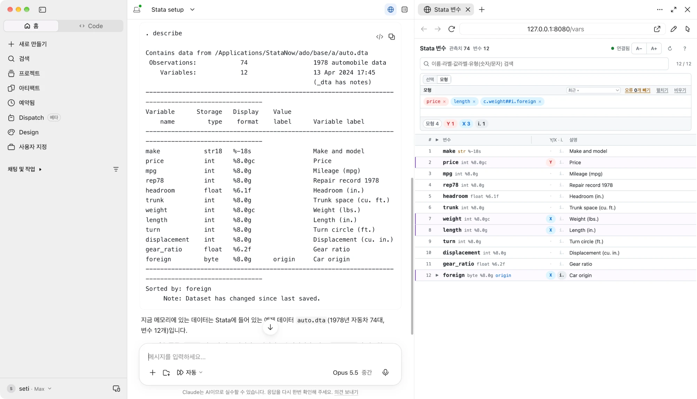
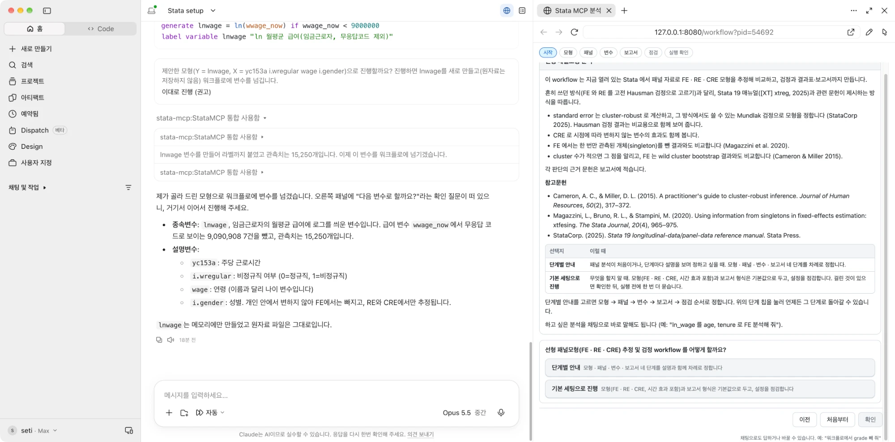
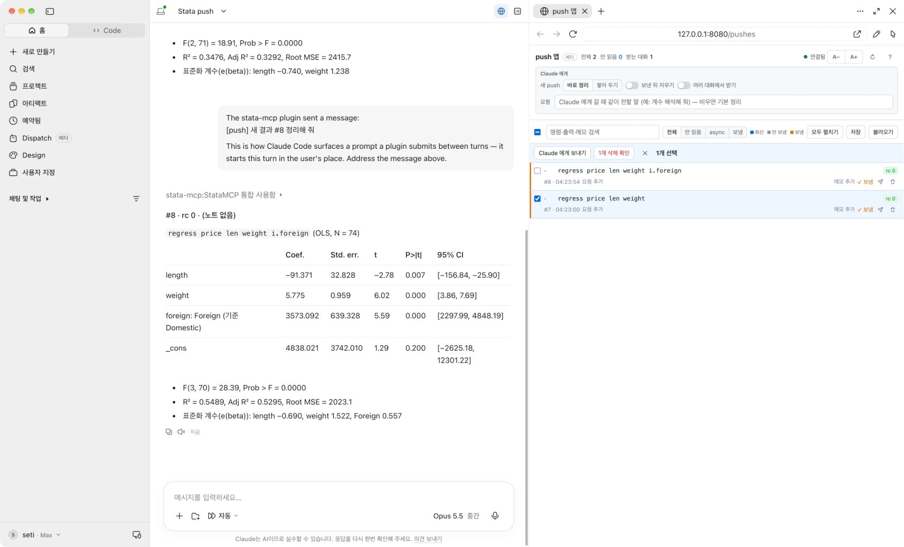

# Usage Guide

> 한국어 문서: [USAGE.md](USAGE.md)

For installation, see [README.en.md](README.en.md).

---

## 1. Start and stop

### 1-1. Startup order

```
1. Start Stata → mcp_connect (server + drone in one go)
2. Start Claude Desktop
3. Toggle cowork mode ON
```

From there, ask for Stata work in the chat, or send results from Stata to Claude with `llm push`.

### 1-2. Full shutdown (server + drone)

```stata
mcp_connect, shutdown
```

Disconnects this Stata (same as the control panel's [Shutdown] button). If no other Stata is connected, the server also stops 1 second later.

### 1-3. Automatic shutdown

When you quit Stata, the server cleans itself up 1 second later (default). If several Stata sessions are connected, it stops when you quit the last one. Use the control panel's Auto-shutdown group (chapter 8) to turn this off (keep the server running) or adjust the wait time, or use the command:

```stata
mcp_watchdog, grace(120)
mcp_watchdog, enabled(0)
```

- `grace(120)` — clean up the server 120 s after Stata quits
- `enabled(0)` — disable auto-cleanup (server stays after Stata quits)

> With a longer wait time, restarting Stata and reconnecting within it keeps the server running without dropping the connection.

> To stop only the server, `mcp_server, stop` also works.

---

## 2. Checking the connection

### 2-1. On the Stata side

If `mcp_connect` finishes without errors, you are connected. To check, press **Server status** in the control panel (`mcp`) or run the command below — it prints the server and drone status.

```stata
mcp_server, status
```

### 2-2. On the Claude side

Type `/stata-setup` in the chat (or ask "is Stata connected?"); Claude answers with the Stata version, OS and working folder in one line:

```
Stata 19.5 MP (8 core) · macOS · working folder /Users/…
```

That line means you are connected. It then loads your working instructions and asks whether to open the variable page (chapter 5).

### 2-3. First-run MCP server approval

The first time you use a new MCP server, an **approval prompt** appears (`Trust this MCP server?` / `Approve` and the like). Tools only work after you approve; once approved, it's automatic afterwards.

### 2-4. Working folder

`/stata-setup` asks whether to switch Stata's working folder when it differs from the Cowork folder. After that, if you move the working folder with `cd` in Stata, Claude notices automatically and asks whether to revert or keep the new folder. Write your preferred handling into your working instructions (CLAUDE.md etc.) and it is applied automatically every time.

> If it does not connect, see chapter 9, Troubleshooting.

---

## 3. Commands

### 3-1. Requesting commands

Ask for Stata work in plain language in the chat:

```
Load the auto dataset and regress price on mpg and weight
```

Claude then works through this flow:
1. Calls the `executeStata` tool → runs `sysuse auto, clear` / `regress price mpg weight` etc.
2. Receives the Stata results (output, r()/e(), graphs) and shows them in the chat
3. For graph commands the response includes `graphDrawn: true` — when an image is needed, Claude calls `exportGraph` → creates `c(pwd)/g_yyyyMMddHHmm_xxxx.png` and returns `graphPath` (absolute) and `graphFilename` (shown automatically when the cowork panel monitors the working folder)
4. Follow-up questions/instructions are welcome (e.g. "plot the residuals too")

Responses include `rc` (Stata return code, 0 = success), so Claude can tell success from failure immediately; on a syntax error it checks the syntax itself via `getHelp` and retries.

### 3-2. Long-running commands (async) — set it running and keep talking

For slow commands like bootstrap / simulate / mi impute, Claude uses `executeStataAsync`:

```
Run a 300,000-rep bootstrap → (immediately) "Started. Feel free to do other things while it runs."
   ... chat freely in the meantime (model questions, writing, planning the next analysis) ...
Done → a conversation with the push app open gets it on its own and summarizes it (otherwise "show me the results") → table + interpretation
```

- Other Stata commands during the run get an immediate `busy` response (no waiting, chat never blocks)
- The completed result (full output + `rc` + elapsed time) goes to the push store — a conversation with the push app open (7-3) receives it as "[push] 새 결과" as soon as it finishes and summarizes it; otherwise say "check the push results" or use `/stata-pull`
- Stored r()/e() results are preserved exactly as in a normal run (query with `getMacro("e(b)")` etc.)
- One job at a time (the Stata engine is single-threaded)

### 3-3. Graphs / saved files

| Kind | Where it goes |
|---|---|
| Graphs | `g_...png` in the current working folder (created only when an image is needed — not auto-saved) |
| Saved files (`save`/`export` etc.) | exactly the path you specified in Stata |

### 3-4. Help / environment lookup

Tools Claude uses to check Stata syntax on its own — you rarely call them yourself, but they respond to plain language too:

```
"What options does xtreg have?"              → getHelp("xtreg") — overview slice (model list + drill-down keys)
"Details on the vce option of xtreg fe"      → getHelp("xtreg","fe.vce") — just that option's detail (cascading drill-down)
"What command is su again?"                  → abbreviations resolved automatically (su→summarize, standard Stata rules)
"Find commands about cluster-robust errors"  → local keyword search → candidate commands + one-line descriptions
"Show the Stata environment/version"         → getStataEnv — 8 essentials: version, edition (BE/SE/MP), OS, install paths
```

- Help comes from an ontology DB (4,464 nodes) that returns **only the slice you need, cascading down** — the default call is an overview (a few hundred tokens); use a `selector` to descend to a model (`fe`), option group (`fe.se`), option detail (`fe.vce`), `examples`, `stored`, `post.predict`, etc. An invalid selector returns the list of valid selectors for that command. See the `/stata-help` skill for the full syntax
- The DB is downloaded by `mcp_setup`, so lookups **answer instantly even while a long command is running**, with no internet needed at query time
- Help for community packages (SSC etc.) works too, if installed — use the full command name
- Refresh the help DB with `mcp_setup, updatedb` (or the control panel's [Update help DB]) — it is regenerated on the distribution side to track Stata updates

---

## 4. Slash-command skills

Start your session with `/stata-setup` — it checks the environment and working folder and loads your working instructions (output format etc.).

The rest, as needed:

- `/stata-exec command` — run exactly as given, no edits or inference
- `/stata-async command` — fire off long jobs (~30s+) and keep talking → on completion it arrives on its own in the conversation with the push app open, otherwise collect it with `/stata-pull` (search with `history keyword`; reading preserves items)
- `/stata-pull` — fetch results you pushed from the Stata window with `llm push > command`
- `/stata-help command` — check syntax. When Claude misuses an option, this corrects it (`xtreg` → `xtreg fe` → `xtreg fe.vce`, cascading)
- `/stata-data-context` — resynchronize when Claude's picture of the data is stale (you changed the data in the Stata window). For a full profile use `/stata-data-fullcontext` (+ codebook)
- `/stata-graph-export` — save the current graph as a PNG in the working folder / `/stata-graph-get` — inspect the graph spec
- `/stata-vars` — open the variable page. Browse names, labels and value labels, tick variables or write a model line, then just say "with the selected variables …" or "run the model" and Claude uses them (`/stata-setup` offers to open it)
- `/stata-push` — open the push app (beta) + receive in this conversation (`/stata-push off` to stop, 7-3)
- `/stata-workflow [procedure]` — start a workflow (beta): panel analysis or panel data build, step-by-step questions through to the report (chapter 6)

Preferences such as output format and analysis rules go into the working folder's CLAUDE.md (Cowork, Claude Code) or the project instructions (chat), and Claude follows them. For a starting point, download the example skill [`stata-instruction-en.zip`](https://raw.githubusercontent.com/mhjung0822/stata-mcp/main/claude-plugins/stata-instruction-en.zip), edit it and add it as a skill (chat/Cowork: skill upload; Claude Code: `~/.claude/skills/stata-instruction/`) — `/stata-setup` then loads it. Panel merging responds to plain language like "merge the waves".

**Natural language vs skills — same job, two styles**

| What you want | In plain language | With a skill | Notes |
|---|---|---|---|
| Open data | "Open the auto dataset" | `/stata-exec sysuse auto` | If you know the exact command,<br>the skill is faster and precise |
| Run a test | "Test for heteroskedasticity" | `/stata-exec estat hettest` | Plain language if you want interpretation,<br>skill if you just want the output |
| Long-running job | "Run a 5000-rep bootstrap" | `/stata-async bootstrap, reps(5000):`<br>`regress price mpg weight foreign` | exec blocks the chat to the end —<br>go async from the start if it's long |
| Check syntax/options | "What vce options are there?" | `/stata-help xtreg fe.vce` | When Claude misuses an option,<br>make it read the original help |
| Collect results | "Get the result I just pushed" | `/stata-pull` | search with `history keyword`,<br>re-fetch with `<id>` |
| Fix stale data picture | "Re-check the current data" | `/stata-data-context` | After changing data in the Stata window,<br>the skill makes it certain |
| Save a graph | "Save the graph as a PNG" | `/stata-graph-export` | exports the current graph<br>to the working folder immediately |

In short: **plain language = your request is interpreted and routed to the right tool or skill** / **a skill = the intended action, performed verbatim**.

---

## 5. The variable page — pick variables while seeing names and labels

Instead of switching to the Stata window to check variable names, keep a variable list next to Claude and use what you pick there directly in your analysis.



**How to open it** (any of these)

- Run `/stata-setup`; it asks "Open the variable page?" → Yes
- Later: `/stata-vars`, or just "open the variable page"
- Type the address: `http://127.0.0.1:8080/vars` (in the Cowork browser panel or any browser; it opens only on the same PC)

**What you can do there**

- See every variable's name, storage type, display format and label at a glance. Variables with value labels have a ▶ on the row; the ▶ in the header expands or collapses all of them. `A−`/`A+` at the top right changes the text size, `?` shows the help
- Search — name, label, value labels, and typing "numeric" or "string" keeps only that type
- The input box has two fields, **Selection** and **Model**; switch between them with `Selection | Model` at the top. Each field keeps its own value
- **Selection** — the variable list for tasks with no roles (summary statistics, tabulations, graphs …). Press ✔ on a row, or type a name in the field and press Enter to make a chip (several separated by spaces; pasting works). Ranges `rep78-foreign`, wildcards `wt*` and `_all` work too, and `Expand` turns them into variable names. The header ✔ selects every variable currently shown
- **Model** — the regression model in Stata syntax on one line (`price mpg i.rep78 c.weight##i.foreign`). The first chip is Y, the rest are X. Pressing a row's `Y`·`X`·`i.` tag rewrites the line as well. `To model →` moves the selection list into the line, and `Recent ▾` brings back a line you used before. Variables in the model are added to the selection list too
- Click a chip to edit it in place, × to remove it, drag to reorder. Type a few letters of a name and candidates appear underneath (↑↓ to choose, Tab or Enter to fill)
- A variable that does not exist becomes a warning chip; `Drop n errors` removes them all at once
- Press the `Selection n`·`Model n`·`Y`·`X`·`i.` badges to see only those variables. Drag the right edge of the `Variable` header to resize the columns; `↻` re-reads anything you changed directly in the Stata window

**How Claude uses it**

- "Summary statistics for the selected variables" → `summarize` on the variables in the selection field
- "Run the model" → `regress` with the model line exactly as written. If the line is empty, Claude asks which variables to use
- If both are empty, Claude does not guess — it asks you to pick variables in the page or name them

Commands run through Claude (creating, dropping, renaming or labelling variables) show up in the page immediately. Commands typed directly in the Stata window appear after you press `↻` or after the next command through Claude. Opening a different dataset clears the selection and the model. The model line is stored inside the data, so it comes back when you open that data again, and it stays in a `save`d file.

---

## 6. Workflow — analysis by a set procedure (beta)

The server asks you step by step about a panel analysis, runs it as answered and produces the report. Two procedures exist for now — **panel analysis** (linear panel models FE · RE · CRE, estimation and tests) and **panel data build** (wave files in the working folder into one panel). It is a beta: wording and order may change.



**How to open it**

- `/stata-workflow` — it first asks which procedure. You can name it, as in `/stata-workflow panel analysis`
- Or just say "run it as a workflow", "FE analysis of lnwage on age tenure in the workflow"
- With a browser panel (Claude Code · Cowork) the workflow page opens in the panel on the right; in plain chat the same questions come as chat questions

**The page**

- Step chips at the top: `Start → Model → Panel → Variables → Report → Check → Confirm run`. Press a chip to go back to that step
- Each box has a question, the options and their explanation, with `Back` `Restart` `OK` underneath
- The first question offers **Step by step** (the four steps with explanations, one after another) or **Proceed with defaults** (keep the defaults, only check the settings, confirm once before running)

**Together with the chat**

- While answering in the page you can write in chat "drop grade in the workflow" or "where is the workflow now" and Claude applies it to the current box
- If a variable has to be created first, create it in chat and hand it to the workflow (the picture above: a log-wage variable is created and handed over, then the page continues)

**The result**

- When the run finishes the report page opens — settings, result tables, sensitivity analysis, references. The HTML is saved in the working folder automatically
- The save box in the report offers `Save Word` `Save Hangul` `Save do-file` `Save all`. The documents contain the result tables and the sensitivity analysis, without interpretation — that is the researcher's part; ask Claude in chat when you want it

---

## 7. Push app — from Stata to Claude

### 7-1. llm push — Push from the Stata GUI (both directions)

Analyze directly in the Stata GUI, then send the results to Claude:

```stata
sysuse auto, clear
regress price mpg weight
llm push
```

Variants:

- `llm push` — pushes r()/e() (added to the store + instant notification)
- `llm push > regress price mpg weight` — runs the command after `>`, pushes the output screen + r()/e()
- `llm push, note(main spec for slides) > regress ..., robust` — attaches a note in plain language (easy to find later)
- `llm push, req(interpret the coefficients) > regress ...` — sends a request for Claude along with the result. In the conversation with the push app open it arrives as "[push] 새 결과 #n — interpret the coefficients" and Claude does just that (it overrides the push app's 「요청」 box). Quotes are fine too: `req("coefficients as a table")`
- `llm push, clear` — clears unread items and pushes fresh (cleanup)

- `llm push` **stores** the result. A conversation with the push app open receives it right away and summarizes it (7-3)
- Claude picks up unread items one by one — push several times in a row and they accumulate in order

### 7-2. The push store — reading does not delete

Retrieved results are not deleted, only **marked as read**. Everything is kept for the session and can be recalled in plain language:

```
"Show me that bootstrap result again"        → found in the history (table of contents) and re-fetched
"Find the ones I ran with robust"            → keyword search over commands, output, and notes
"Tag result #3 with a 'final spec' note"     → attaches a note (searchable)
"Save all results so far to a file"          → writes a snapshot file in the working folder
"Load the file I saved yesterday"            → reloads the snapshot (continue where you left off)
```

- Results are auto-saved even after the session ends — quit in a hurry and pick up next session
- If the server is briefly down, results are kept and delivered later (nothing is lost)

> If the notification doesn't appear on its own, just say **"check the push results"** in the chat.

### 7-3. The push app window — collect results and send them to Claude (beta)

In Claude Code and Cowork you can see push results as a list and send the ones you pick to Claude.



**Open / close**

- **"Open the push app"** or `/stata-push` — the push app opens in the side panel and this conversation starts receiving pushes
- **"Close the push app"** or `/stata-push off` — this conversation stops receiving
- **"Is push on?"** — tells you whether this conversation is receiving
- The server tray icon menu **Open Push page** / **Open Variables page** also opens them in your browser (to look without Claude)

> **In Cowork, receiving goes to sleep when the conversation is idle.** After a few minutes (2–3) with no message in the conversation that is receiving, it stops and the push app header shows 「받는 대화 없음」 (no receiving conversation). Pushes that arrive meanwhile are not lost: they are kept, and sending any message in that conversation brings them in right after the reply. Claude Code (the desktop Code tab) does not sleep — leave it on and pushes come in right away.

**The 「Claude 에게」 (To Claude) box**

- 「바로 정리」 (Summarize now) — Claude summarizes each new push right away / 「쌓아 두기」 (Keep) — pushes only pile up in the list and go to Claude when you press [Claude 에게 보내기] (Send to Claude)
- 「요청」 (Request) — what to say along with a send (e.g. compare the two regressions in one table). 「요청 추가」 (Add request) on a card applies to that result only; a push sent with `llm push, req(…)` from Stata arrives with its request already filled in
- 「보낸 뒤 지우기」 (Delete after sending) — results Claude has taken are removed from the list
- 「여러 대화에서 받기」 (Receive in several conversations) — off (default): only the conversation that opened the push app last receives. On: every conversation that opened it receives

**The list**

- Colors: blue = latest, gray = not sent, orange = sent
- Badge 「끈 사이 도착」 (arrived while off) = came in while no conversation was receiving; it is not sent on its own — press [보내기] (Send) if you want it. 「지연 도착」 (arrived late) = came in while the server was down (same handling)
- 「받는 대화」 (Receiving) in the header — how many conversations are receiving now. With 「없음」 (none), sent results wait until a conversation runs `/stata-push`
- Click a card's header to expand or collapse · notes · search · filters (all · unread · async · sent)
- [저장] (Save) · [불러오기] (Load) — as `push_*.json` in Stata's working folder
- Results that arrive while Claude is answering come in right after the answer ends

While you work with the variable window open, a new push shows a notice at its top.

In the chat tab, say "show me the push results" to fetch them.

---

## 8. Operations

### 8-1. Control panel (GUI) — connect, status, update and uninstall as buttons

Type `mcp` (= `db mcp`) in Stata to open the control-panel dialog — connect / restart / shutdown, server status (including version), auto-shutdown settings, help-DB update, and uninstall, all as buttons.

```stata
mcp
mcp_setup
```

- `mcp` (= `db mcp`) — control-panel dialog
- `mcp_setup` — setup menu + help-DB download (links for start / uninstall)
- `mcp_setup, update` — reinstall the latest version (restart Stata and run it before connecting, then restart again)
- `mcp_setup, updatecheck(off)` — turn off the new-version check and anonymous connection count on connect (`on` to turn it back on)

> Menu-bar registration (User ▸ Stata-MCP) is handled by `mcp_setup`. If the menu
> is missing on the next launch, run `mcp_menu, install` and follow the printed instructions.

### 8-2. Full uninstall

```stata
mcp_uninstall
```

- `mcp_uninstall` — preview (deletes nothing): lists targets + a confirm link
- `mcp_uninstall, confirm` — removes ado/dlg/jar + menu registration (keeps settings/instructions)
- `mcp_uninstall, confirm all` — also removes settings and instruction data

> The **Uninstall** button in the control panel (`db mcp`) runs the preview (first line above) as well.

### 8-3. Using several Stata sessions (advanced)

Open several Stata windows and run `mcp_connect` in each — all of them connect. Claude uses one Stata window by default. When there are several, Claude asks which one to use.

#### Terminal Stata (Mac)

You can also start Stata in a terminal and connect it. Give it a name so you can pick it, e.g. "run it in c1".

```bash
stata-mp -q 'mcp_connect, name(c1)'
```

#### Separate Stata from Claude Code (Mac)

Claude Code can start extra Stata sessions with no window and run several models at the same time, while your Stata window stays free. This is off by default. To turn it on, add the line below to `stata_mcp.properties` and connect Stata again.

```
CONSOLE_TOOLS=on
```

- An extra Stata does not share the data in your window. Save the data you need to a file first.
- Up to 3 can run at the same time.

---

## 9. Troubleshooting

### 9-1. When it won't connect

- Run `mcp_connect` again in Stata (reconnects the drone)
- If the server is down, restart it with `mcp_server`
- Check status with the **Server status** button in the control panel (`db mcp`)

### 9-2. Java version error on mcp_connect (drone won't start)

Symptom: `mcp_connect` stops with a message saying Stata's Java is too old and Java 17 or later is required:

```
[Stata-MCP] Stata 의 Java 가 11.0.x 입니다 — Java 17 이상이 필요합니다.
```

Or it prints this error in red:

```
java.lang.UnsupportedClassVersionError: ... has been compiled by a more recent
version of the Java Runtime (class file version 61.0), this version of the
Java Runtime only recognizes class file versions up to 55.0
```

Stata's bundled Java is outdated. Update Stata to the latest revision:

```stata
update all
```

After updating, **restart Stata** → run `mcp_connect` again.

> If updating is not an option (site licenses etc.), install JDK 17 and point Stata at it with `java set home` — see `help java`. Check the current Java with `java query`.
