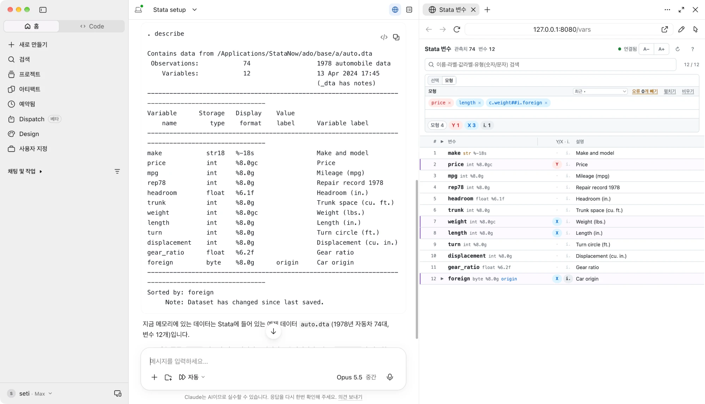
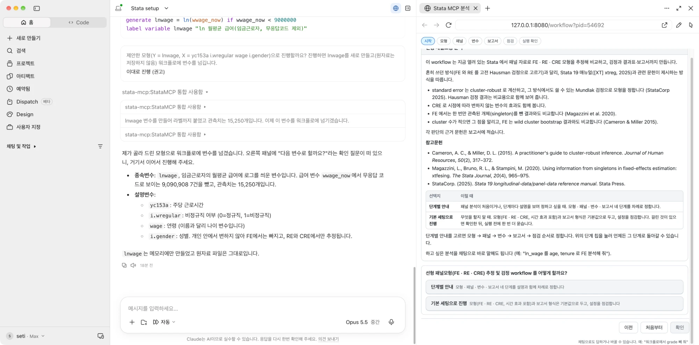
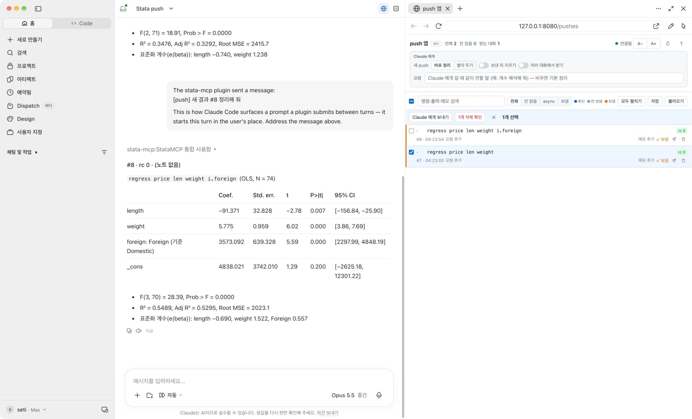

# 사용 가이드

> English: [USAGE.en.md](USAGE.en.md)

설치는 [README.md](README.md) 참고.

---

## 1. 시작과 종료

### 1-1. 시작 순서

```
1. Stata 실행 → mcp_connect (서버 + 드론 한 번에)
2. Claude Desktop 실행
3. 코워크 모드 토글 ON
```

이후 채팅에서 Stata 작업을 요청하거나, Stata 에서 `llm push` 로 결과를 Claude 로 보냅니다.

### 1-2. 완전 종료 (서버 + 드론)

```stata
mcp_connect, shutdown
```

이 Stata 의 연결을 끊습니다 (제어판 [Shutdown] 버튼과 동일). 연결된 Stata 가 더 없으면 서버도 1초 뒤 꺼집니다.

### 1-3. 자동 종료

Stata 를 종료하면 서버도 1초 뒤(기본) 스스로 정리됩니다. Stata 를 여러 개 연결했다면 마지막 Stata 를 끌 때 꺼집니다. 제어판(8장)의 Auto-shutdown 그룹에서 끄거나(서버 상주) 대기 시간을 조절할 수 있고, 명령으로도 됩니다:

```stata
mcp_watchdog, grace(120)
mcp_watchdog, enabled(0)
```

- `grace(120)` — Stata 종료 후 120초 뒤 서버 정리
- `enabled(0)` — 자동 정리 끄기 (Stata 를 꺼도 서버 유지)

> 대기 시간을 늘려 두면, 그 안에 Stata 를 다시 켜고 연결할 때 서버가 끊기지 않고 그대로 이어집니다.

> 서버만 따로 내리려면 `mcp_server, stop` 도 가능합니다.

---

## 2. 연결 확인

### 2-1. Stata 쪽

`mcp_connect` 가 오류 없이 끝나면 연결된 것입니다. 확인하려면 제어판(`mcp`)의 **Server status** 버튼을 누르거나 아래 명령을 치면 서버와 드론 상태가 나옵니다.

```stata
mcp_server, status
```

### 2-2. Claude 쪽

채팅에 `/stata-setup` 을 치면 (또는 "Stata 연결됐어?") Claude 가 Stata 버전·OS·작업폴더를 한 줄로 답합니다:

```
Stata 19.5 MP (8 core) · macOS · 작업폴더 /Users/…
```

이 한 줄이 돌아오면 연결된 것입니다. 이어서 작업 지침을 읽고 변수 창을 열지 묻습니다 (5장).

### 2-3. 첫 실행 시 MCP 서버 승인

새 MCP 서버를 처음 사용할 때 **승인 프롬프트**가 뜹니다 (`Trust this MCP server?` / `Approve` 계열). 승인해야 도구 호출이 되며, 한 번 승인하면 이후 자동입니다.

### 2-4. 작업폴더

`/stata-setup` 은 Stata 작업폴더가 코워크 폴더와 다르면 바꿀지 묻습니다. 그 뒤에도 Stata 에서 `cd` 로 작업폴더를 옮기면 Claude 가 자동으로 알아차려, 되돌릴지 새 폴더를 유지할지 안내합니다. 작업 지침(CLAUDE.md 등)에 처리 방식을 적어두면 매번 자동 응대합니다.

> 연결이 안 되면 9장 문제 해결을 보세요.

---

## 3. 명령

### 3-1. 명령 요청

채팅창에 자연어로 Stata 작업 요청:

```
auto 데이터셋 불러와서 price를 mpg와 weight로 회귀해줘
```

Claude가 다음 흐름으로 동작:
1. `executeStata` tool 호출 → `sysuse auto, clear` / `regress price mpg weight` 등 실행
2. Stata 결과(output, r()/e(), 그래프) 받아 채팅에 표시
3. 그래프 명령이면 응답에 `graphDrawn: true` 포함 — 이미지가 필요할 때 Claude 가 `exportGraph` 호출 → `c(pwd)/g_yyyyMMddHHmm_xxxx.png` 생성, `graphPath`(절대경로)·`graphFilename` 응답 (cowork 패널이 작업폴더 모니터링 시 자동 표시)
4. 후속 질문/지시 가능 (예: "잔차 그래프도 그려줘")

응답에는 `rc` (Stata 반환코드, 0=성공) 가 포함되어 Claude 가 성공/실패를 즉시 판별하고, 문법 오류 시 `getHelp` 로 스스로 확인 후 재시도합니다.

### 3-2. 장기 실행 명령 (async) — 돌려놓고 계속 대화

bootstrap/simulate/mi impute 같은 오래 걸리는 명령은 Claude 가 `executeStataAsync` 로 던집니다:

```
30만 번 bootstrap 돌려줘 → (즉시) "실행 시작했습니다. 도는 동안 다른 작업 하셔도 됩니다"
   ... 그동안 자유롭게 대화 (모형 질문, 문서 작성, 다음 분석 설계) ...
완료 → push 앱을 연 대화면 저절로 들어와 정리 (아니면 "결과 보여줘") → 표·해석
```

- 실행 중 다른 Stata 명령은 즉시 `busy` 응답 (기다리며 채팅이 끊기지 않음)
- 완료 결과(출력 전문 + `rc` + 소요시간)는 push 저장소에 쌓입니다 — push 앱을 연 대화(7-3)는 끝나는 대로 「[push] 새 결과」로 받아 정리하고, 아니면 "push 결과 봐줘" 또는 `/stata-pull` 로 가져옵니다
- r()/e() 저장 결과는 일반 실행과 동일하게 보존 (`getMacro("e(b)")` 등으로 조회)
- 한 번에 하나만 실행 (Stata 엔진이 단일이라서)

### 3-3. 그래프/저장 파일

| 종류 | 어디로 |
|---|---|
| 그래프 | 현재 작업폴더에 `g_...png` (이미지가 필요할 때만 생성 — 자동 저장 안 함) |
| 저장 파일 (`save`/`export` 등) | 사용자가 Stata 에서 지정한 그 경로 |

### 3-4. 도움말 / 환경 조회

Claude 가 Stata 명령을 헷갈릴 때 스스로 확인하는 도구들 — 사용자가 직접 부를 일은 적지만, 자연어로도 활용할 수 있습니다:

```
"xtreg 옵션 뭐 있었지?"                → getHelp("xtreg") — 개요 slice (모델 목록 + 하강 키)
"xtreg fe 의 vce 옵션 자세히"           → getHelp("xtreg","fe.vce") — 그 옵션 상세만 (계단식 하강)
"su 가 무슨 명령이더라"                 → 약어 자동 해석 (su→summarize, Stata 규칙 그대로)
"클러스터 로버스트 관련 명령 찾아줘"      → 로컬 키워드 검색 → 관련 명령 후보 + 한줄설명
"Stata 환경/버전 알려줘"               → getStataEnv — 버전·에디션(BE/SE/MP)·OS·설치경로 핵심 8항목
```

- 도움말은 온톨로지 DB(노드 4,464개)에서 **필요한 slice 만 계단식 반환** — 기본 호출은 개요(수백 토큰), `selector` 로 모델(`fe`)/옵션그룹(`fe.se`)/옵션상세(`fe.vce`)/`examples`/`stored`/`post.predict` 등 하강. 잘못된 selector 는 그 명령의 유효 selector 목록을 돌려줌. 자세한 문법은 `/stata-help` 스킬 참고
- `mcp_setup` 다운로드 DB 라 **장기 명령이 도는 중에도 즉답**, 조회 시 인터넷 불필요
- SSC 등 커뮤니티 패키지 도움말도 조회 가능 (설치돼 있으면 — 풀네임으로)
- 도움말 DB 는 `mcp_setup, updatedb`(또는 제어판 [Update help DB])로 최신화 (Stata 본체 업데이트에 맞춰 배포측에서 재생성)

---

## 4. 슬래시 명령 스킬

`/stata-setup` 으로 세션을 시작하세요 — 환경·작업폴더 확인 + 작업 지침(출력형식 등) 로드.

나머지는 필요할 때:

- `/stata-exec 명령` — 수정·추론 없이 그대로 실행
- `/stata-async 명령` — 오래 걸리는 작업(~30초+)을 던져두고 대화 계속 → 완료는 push 앱을 연 대화로 저절로, 아니면 `/stata-pull` 로 회수 (`history 키워드` 검색, 읽어도 보존)
- `/stata-pull` — Stata 창에서 `llm push > 명령` 한 결과 가져오기
- `/stata-help 명령` — 문법 확인. Claude 가 옵션을 잘못 쓰면 이걸로 교정 (`xtreg` → `xtreg fe` → `xtreg fe.vce` 계단식)
- `/stata-data-context` — Claude 가 데이터를 잘못 알고 있을 때 (Stata 창에서 데이터를 바꾼 경우) 재동기화. 상세 파악은 `/stata-data-fullcontext` (+ codebook)
- `/stata-graph-export` — 그래프를 PNG 파일로 작업폴더에 저장 / `/stata-graph-get` — 그래프 spec 조회
- `/stata-vars` — 변수 창 열기. 변수 이름·라벨·값라벨을 보면서 체크하거나 모형식을 적어 두면, "선택한 변수로 …" "모형 돌려 줘" 라고만 해도 Claude 가 그 변수·식을 씁니다 (`/stata-setup` 이 열지 물어봄)
- `/stata-push` — push 앱(베타) 열기 + 이 대화에서 받기 (`/stata-push off` 로 끔, 7-3)
- `/stata-workflow [절차]` — 워크플로(베타) 시작. 패널 분석·패널 데이터 생성을 단계별 질문으로 진행해 보고서까지 (6장)

출력형식·분석 규칙 같은 선호는 작업 폴더의 CLAUDE.md(코워크·Claude Code)나 프로젝트 지침(채팅)에 적어 두면 Claude 가 그대로 따릅니다. 지침 예시 스킬 [`stata-instruction.zip`](https://raw.githubusercontent.com/mhjung0822/stata-mcp/main/claude-plugins/stata-instruction.zip) 을 내려받아 고친 뒤 스킬로 올리면(채팅·코워크: 스킬 업로드 / Claude Code: `~/.claude/skills/stata-instruction/`) `/stata-setup` 이 그것을 읽습니다. 패널 병합은 "웨이브 합쳐줘" 같은 자연어로.

**자연어 vs 스킬 — 같은 작업, 두 방식**

| 하고 싶은 것 | 자연어로 | 스킬로 | 비고 |
|---|---|---|---|
| 데이터 열기 | "auto 데이터 열어줘" | `/stata-exec sysuse auto` | 명령을 정확히 알면<br>스킬이 빠르고 정확 |
| 검정 실행 | "이분산 검정 해줘" | `/stata-exec estat hettest` | 해석까지 원하면 자연어,<br>결과만 보려면 스킬 |
| 오래 걸리는 작업 | "부트스트랩 5000번 돌려줘" | `/stata-async bootstrap, reps(5000):`<br>`regress price mpg weight foreign` | exec 면 끝까지 대화 막힘 —<br>길면 스킬로 바로 비동기 |
| 문법·옵션 확인 | "vce 옵션 뭐 있어?" | `/stata-help xtreg fe.vce` | Claude 가 옵션 잘못 쓰면<br>원문을 읽혀 교정 |
| 결과 회수 | "방금 push 한 결과 가져와" | `/stata-pull` | 검색 `history 키워드`,<br>재조회 `<id>` |
| 데이터 인식 교정 | "지금 데이터 다시 확인해봐" | `/stata-data-context` | Stata 창에서 데이터<br>바꾼 뒤엔 스킬로 확실히 |
| 그래프 저장 | "그래프 PNG 로 저장해줘" | `/stata-graph-export` | 현재 그래프를 작업폴더로<br>즉시 내보냄 |

요컨대 **자연어 = 질의를 해석해 적절한 도구·스킬을 호출** / **스킬 = 의도된 동작을 그대로 수행**.

---

## 5. 변수 창 — 변수 이름·라벨을 보면서 고르기

Stata 창으로 오가며 변수명을 확인할 필요 없이, Claude 옆에 변수 목록을 띄워 두고 거기서 고른 변수를 바로 분석에 쓸 수 있습니다.



**여는 방법** (셋 중 하나)

- `/stata-setup` 을 실행하면 "변수 창을 열까요?" 라고 묻습니다 → 네
- 나중에 열려면 `/stata-vars`, 또는 "변수 창 열어 줘"
- 주소 직접 입력: `http://127.0.0.1:8080/vars` (코워크 브라우저 패널·일반 브라우저 어디서나. 같은 PC 에서만 열립니다)

**창에서 할 수 있는 것**

- 변수 이름·저장 형식·표시 형식·라벨을 한눈에. 값라벨이 있는 변수는 행의 ▶, 머리글의 ▶ 는 전부 펼치기·접기. 오른쪽 위 `A−`/`A+` 는 글자 크기, `?` 는 도움말
- 검색 — 이름·라벨·값라벨, 그리고 "숫자"·"문자" 라고 치면 그 유형만
- 입력 상자는 **선택** 과 **모형** 두 칸이 있고 위의 `선택 | 모형` 으로 바꿔 봅니다. 두 칸의 값은 각각 유지됩니다
- **선택** — 역할 없는 작업(기초통계·빈도표·그래프 등)에 쓸 변수 목록. 행의 ✔ 를 누르거나, 칸에 이름을 치고 Enter 를 누르면 칩이 됩니다 (공백으로 여러 개, 붙여넣기 가능). `rep78-foreign` 범위, `wt*` 와일드카드, `_all` 전부도 되고 `펼치기` 를 누르면 변수 이름으로 풀어집니다. 머리글 ✔ 는 표시된 변수 모두
- **모형** — 회귀 모형식을 Stata 문법 그대로 한 줄로 (`price mpg i.rep78 c.weight##i.foreign`). 첫 칩이 Y, 나머지가 X. 행의 `Y`·`X`·`i.` 표지를 눌러도 식이 고쳐집니다. `모형으로 →` 는 선택 목록을 식으로 옮기고, `최근 ▾` 에서 전에 쓴 식을 다시 고릅니다. 식에 넣은 변수는 선택 목록에도 들어갑니다
- 칩은 클릭하면 그 자리에서 고치고, × 로 빼고, 끌어서 순서를 바꿉니다. 이름을 몇 글자 치면 아래에 후보가 뜹니다 (↑↓ 로 고르고 Tab 또는 Enter)
- 없는 변수는 경고색 칩이 되고 `오류 n개 빼기` 로 한 번에 지웁니다
- `선택 n`·`모형 n`·`Y`·`X`·`i.` 배지를 누르면 그 변수만 보입니다. 머리글 `변수` 오른쪽 경계를 끌면 열 폭 조절, `↻` 는 Stata 창에서 직접 바꾼 내용을 다시 읽기

**Claude 는 이렇게 씁니다**

- "선택한 변수 기초통계량" → 선택 칸의 변수로 `summarize`
- "모형 돌려 줘" → 모형 칸의 식을 그대로 `regress` 에. 식이 비어 있으면 어느 변수인지 물어봅니다
- 둘 다 비어 있으면 추측하지 않고 변수 창에서 고르거나 이름을 말해 달라고 합니다

Claude 를 통해 실행한 명령(변수 생성·삭제·이름 변경·라벨 등)은 창에 바로 반영됩니다. Stata 창에 직접 친 명령은 `↻` 를 누르거나 다음 Claude 명령 때 반영됩니다. 다른 데이터를 열면 선택과 모형은 비워집니다. 모형식은 데이터 안에 함께 저장되므로 그 데이터를 다시 열면 되살아나고, `save` 한 파일에도 남습니다.

---

## 6. 워크플로 — 정해진 절차로 분석하기 (베타)

패널 분석을 서버가 단계마다 묻고, 답한 대로 실행해 보고서까지 만듭니다. 지금은 두 절차가 있습니다 — **패널 분석**(선형 패널모형 FE · RE · CRE 추정과 검정), **패널 데이터 생성**(작업폴더의 웨이브 파일을 하나의 패널로). 베타라 문구와 순서가 바뀔 수 있습니다.



**여는 방법**

- `/stata-workflow` — 어떤 절차를 할지부터 묻습니다. `/stata-workflow 패널 분석` 처럼 절차를 같이 적어도 됩니다
- "워크플로로 돌려줘", "lnwage 를 age tenure 로 워크플로 FE 분석" 처럼 말해도 됩니다
- 브라우저 패널이 있는 환경(Claude Code · 코워크)이면 오른쪽 패널에 워크플로 화면이 열리고, 일반 채팅에서는 같은 질문이 채팅으로 옵니다

**화면**

- 위의 단계 칩 `시작 → 모형 → 패널 → 변수 → 보고서 → 점검 → 실행 확인`. 칩을 누르면 그 단계로 돌아갑니다
- 상자마다 질문·선택지·설명이 있고 아래 `이전` `처음부터` `확인` 으로 움직입니다
- 첫 질문은 **단계별 안내**(네 단계를 설명과 함께 차례로) 또는 **기본 세팅으로 진행**(기본값으로 두고 점검만, 실행 전에 한 번 확인) 중 하나

**채팅과 같이 씁니다**

- 화면에서 답하는 동안 채팅에 "워크플로에서 grade 빼 줘", "워크플로 지금 어디야" 라고 하면 Claude 가 그 상자에 반영합니다
- 변수를 먼저 만들어야 하면 채팅에서 만들고 워크플로에 넘기면 됩니다 (위 그림: 로그 급여 변수를 만들어 넘긴 뒤 화면에서 이어감)

**결과**

- 실행이 끝나면 보고서 화면이 열립니다 — 세팅, 결과표, 민감도 분석, 참고문헌. HTML 은 작업폴더에 자동 저장
- 보고서의 저장 상자에서 `Word 저장` `한글 저장` `do-file 저장` `모두 저장`. 문서에는 결과표와 민감도 분석이 들어가고 해석은 넣지 않습니다 — 해석은 연구자의 몫이고, 필요하면 채팅에서 Claude 에게 물어보세요

---

## 7. push 앱 — Stata 에서 Claude 로

### 7-1. llm push — Stata GUI에서 push (양방향)

Stata GUI에서 직접 분석 후 결과를 Claude로 전송:

```stata
sysuse auto, clear
regress price mpg weight
llm push
```

변형:

- `llm push` — r()/e() push (저장소에 add + 즉시 알림)
- `llm push > regress price mpg weight` — `>` 뒤의 명령 실행 + 결과화면 + r()/e() push
- `llm push, note(발표용 본검정) > regress ..., robust` — 자연어 메모 첨부 (나중에 찾기 쉬움)
- `llm push, req(계수 해석해 줘) > regress ...` — Claude 에게 할 요청을 함께 보냄. push 앱을 연 대화에 「[push] 새 결과 #n — 계수 해석해 줘」로 들어가 그대로 처리합니다 (push 앱의 「요청」 칸보다 우선). `req("계수만 표로")` 처럼 따옴표로 묶어도 됩니다
- `llm push, clear` — 안 읽은 항목 비우고 새로 push (잔재 정리)

- `llm push` 하면 결과가 **저장소에 쌓입니다**. push 앱을 연 대화는 바로 받아 정리합니다 (7-3)
- Claude 는 안 읽은 것부터 하나씩 가져옵니다 — 빠르게 여러 번 push 해도 순서대로 누적됩니다

### 7-2. push 저장소 — 읽어도 사라지지 않습니다

가져간 결과는 삭제되지 않고 **읽음 표시**만 됩니다. 세션 동안 전부 보관되어 자연어로 다시 부를 수 있습니다:

```
"아까 그 bootstrap 결과 다시 보여줘"        → 목차(history)에서 찾아 재조회
"robust 로 돌린 것들만 찾아줘"              → 명령·출력·메모를 키워드 검색
"3번 결과에 '최종 스펙' 메모 달아줘"          → note 부여 (검색 대상)
"지금까지 결과 전부 파일로 저장해"            → 작업폴더에 스냅샷 파일로 저장
"어제 저장한 파일 불러와"                    → 스냅샷 재적재 (이어서 작업)
```

- 결과는 세션 종료 후에도 자동 저장돼, 급히 꺼도 다음 세션에서 이어 볼 수 있습니다
- 서버가 잠시 꺼져 있어도 결과는 보관됐다가 다시 전달됩니다 (유실 없음)

> 알림이 자동으로 안 보이면 채팅에 **"push 결과 봐줘"** 라고 하면 가져옵니다.

### 7-3. push 앱 화면 — 결과를 모아 보고 Claude 에게 보내기 (베타)

Claude Code·코워크에서 push 결과를 목록으로 보고, 골라서 Claude 에게 보낼 수 있습니다.



**열기·끄기**

- **"푸쉬앱 열어 줘"** 또는 `/stata-push` — 옆 패널에 push 앱이 열리고, 이 대화가 push 를 받기 시작합니다
- **"푸쉬앱 꺼 줘"** 또는 `/stata-push off` — 이 대화는 더 받지 않습니다
- **"push 켜져 있어?"** — 이 대화가 받고 있는지 알려 줍니다
- 서버 트레이 아이콘 메뉴 **Open Push page** / **Open Variables page** 로도 브라우저에서 열 수 있습니다 (Claude 없이 보기만 할 때)

**「Claude 에게」 상자**

- 「바로 정리」 — 새 push 가 오면 Claude 가 바로 정리합니다 / 「쌓아 두기」 — 목록에만 쌓고 [Claude 에게 보내기] 를 누를 때 갑니다
- 「요청」 — 보낼 때 함께 전할 말 (예: 두 회귀 계수를 비교표로 정리해 줘). 카드의 「요청 추가」로 그 결과에만 따로 적을 수 있고, Stata 에서 `llm push, req(…)` 로 보내면 그 요청이 미리 적혀 옵니다
- 「보낸 뒤 지우기」 — Claude 가 가져간 결과를 목록에서 지웁니다
- 「여러 대화에서 받기」 — 끄면(기본) 마지막에 push 앱을 연 대화 하나만 받습니다. 켜면 연 대화 모두가 받습니다

**목록**

- 색: 파랑 = 최신, 회색 = 안 보냄, 주황 = 보냄
- 머리줄 「받는 대화」 — 지금 받는 대화 수. 「없음」이면 보낸 결과는 쌓여 있다가, 대화에서 `/stata-push` 하면 그 대화가 받습니다
- 카드 머리를 누르면 펼치기·접기 · 메모 · 검색 · 필터(전체·안 읽음·async·보냄)
- [저장]·[불러오기] — Stata 작업폴더에 `push_*.json` 으로
- Claude 가 답하는 중에 온 결과는 답이 끝난 뒤 이어서 들어옵니다

변수 창을 보면서 작업할 때 새 push 가 오면 변수 창 위에 알림이 뜹니다.

채팅 탭에서는 "push 결과 봐줘" 로 가져옵니다.

---

## 8. 운영

### 8-1. 제어판 (GUI) — 연결·상태·업데이트·제거를 버튼으로

Stata 에서 `mcp` (= `db mcp`) 를 치면 제어판 다이얼로그가 뜹니다 — 연결/재시작/종료, 서버 상태(버전 포함), 자동 종료 설정, 도움말 DB 갱신, 제거를 버튼으로.

```stata
mcp
mcp_setup
```

- `mcp` (= `db mcp`) — 제어판 다이얼로그
- `mcp_setup` — 설정 메뉴 + 도움말 DB 다운로드 (기동/제거 링크)
- `mcp_setup, update` — 최신 버전으로 재설치 (Stata 를 재시작한 뒤 연결하기 전에 실행, 설치 후 다시 재시작)
- `mcp_setup, updatecheck(off)` — 연결 시 새 버전 확인·연결 횟수 집계 끄기 (`on` 으로 다시 켜기)

> 메뉴바 등록(User ▸ Stata-MCP)은 `mcp_setup` 이 함께 처리합니다. 다음 실행에서
> 메뉴가 안 보이면 `mcp_menu, install` 을 실행하고 출력 안내를 따르세요.

### 8-2. 전체 제거

```stata
mcp_uninstall
```

- `mcp_uninstall` — 미리보기 (삭제 안 함): 대상 목록 + confirm 링크 출력
- `mcp_uninstall, confirm` — ado/dlg/jar + 메뉴 등록 삭제 (설정/지침 보존)
- `mcp_uninstall, confirm all` — 설정/지침 데이터까지 삭제

> 제어판(`db mcp`)의 **Uninstall** 버튼으로도 미리보기(위 첫 줄)가 실행됩니다.

### 8-3. Stata 여러 개 쓰기 (고급)

Stata 창을 여러 개 띄우고 각각 `mcp_connect` 하면 모두 연결됩니다. Claude 는 기본으로 Stata 창 하나를 씁니다. 창이 여러 개면 어느 창을 쓸지 Claude 가 물어봅니다.

#### 터미널 Stata (Mac)

터미널에서 Stata 를 띄워 연결할 수도 있습니다. 이름을 붙여 두면 "c1 에서 돌려줘" 처럼 고를 수 있습니다.

```bash
stata-mp -q 'mcp_connect, name(c1)'
```

#### Claude Code 에서 별도 Stata 띄우기 (Mac)

Claude Code 가 화면 없는 Stata 를 따로 띄워, 여러 모형을 동시에 돌리게 할 수 있습니다. 그동안 Stata 창은 막히지 않습니다. 기본은 꺼져 있습니다. 켜려면 `stata_mcp.properties` 에 아래 한 줄을 넣고 Stata 를 다시 연결하세요.

```
CONSOLE_TOOLS=on
```

- 별도 Stata 는 창의 데이터를 공유하지 않습니다. 쓸 데이터는 파일로 저장해 두세요.
- 동시에 3개까지 띄울 수 있습니다.

---

## 9. 문제 해결

### 9-1. 연결이 안 될 때

- Stata 에서 `mcp_connect` 을 다시 실행 (드론 재연결)
- 서버가 꺼져 있으면 `mcp_server` 로 다시 기동
- 제어판(`db mcp`)의 **Server status** 버튼으로 상태 확인

### 9-2. mcp_connect 시 Java 버전 오류 (드론이 시작 안 됨)

증상: `mcp_connect` 가 아래처럼 안내하고 멈춤.

```
[Stata-MCP] Stata 의 Java 가 11.0.x 입니다 — Java 17 이상이 필요합니다.
```

또는 붉은 글씨로 아래 에러가 출력됨.

```
java.lang.UnsupportedClassVersionError: ... has been compiled by a more recent
version of the Java Runtime (class file version 61.0), this version of the
Java Runtime only recognizes class file versions up to 55.0
```

Stata 에 내장된 Java 가 구버전이어서 생기는 문제입니다. Stata 를 최신으로 업데이트하세요:

```stata
update all
```

업데이트 후 **Stata 재시작** → `mcp_connect` 재실행.

> 업데이트가 어려운 환경(사이트 라이선스 등)이면 JDK 17 설치 후 Stata 에서 `java set home` 으로 지정 — `help java` 참고. 현재 Java 는 `java query` 로 확인.
